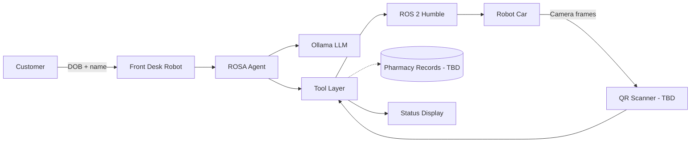

# Pharm Rover

**Embodied Agentic AI for Pharmacy Prescription Pickup Verification**

Pharm Rover is a customer-facing robotic car that lives at the pharmacy front desk. When a walk-in customer arrives, it confirms their identity, looks up their prescriptions, drives to the correct shelves, scans each medicine's QR code, and reports whether the prescription is filled and ready for pickup.

> **Status:** Design and implementation in progress. Pharmacy record access, QR verification, and shelf mapping are marked **TBD** until the backend interfaces are defined.

---

## Overview

Determining whether a prescription is ready for pickup often requires a pharmacist or technician to leave the counter, check the shelf, and return. Pharm Rover automates that status check while keeping the customer interaction at the front desk.

The robot has two operating states:

- **Rest** — parked at the front desk, available to help.
- **In transit** — actively navigating the pharmacy to verify prescription status.

Pharm Rover does not dispense medication. It only reports whether a prescription is filled and ready.

---

## How It Works

1. A walk-in customer arrives at the front desk.
2. The robot checks whether it is at the desk and available.
3. The customer provides their **date of birth** and **first and last name**.
4. The robot confirms the details against the customer record.
5. The robot retrieves the prescriptions the customer is picking up.
6. For each drug, the robot gets a shelf number and a robot-readable location.
7. The robot navigates to the shelf, avoids obstacles, and faces the shelf.
8. The robot scans the medicine's QR code and records **filled** or **not ready**.
9. The robot returns to the front desk.
10. The robot displays the status for the customer.

---

## System Architecture



| Layer | Responsibility |
|---|---|
| **Customer interface** | Collects identity details and presents prescription status |
| **ROSA agent** | Converts natural-language intent into tool calls |
| **Ollama** | Local LLM inference for agent reasoning |
| **Tool layer** | Validates inputs and exposes robot/pharmacy actions |
| **ROS 2** | Robot middleware for navigation, sensors, and display |
| **Robot car** | Differential-drive platform with camera, IMU, and range sensors |

---

## Robot States

| State | Description |
|---|---|
| `REST` | Parked at the front desk; available for a customer |
| `BUSY` | Helping a customer; not available for a new request |
| `IN_TRANSIT` | Navigating to a shelf or back to the desk |
| `DISPLAYING` | Showing the prescription status at the front desk |
| `ERROR` | Recoverable failure, such as a lost path or unreadable QR code |
| `E_STOP` | All movement halted; requires operator reset |

The agent checks robot availability before starting a new interaction.

---

## Agent Tools

| Tool | Purpose | Planned ROS 2 / Backend Interface |
|---|---|---|
| `get_robot_status` | Returns location, availability, battery, and sensor health | `/odom`, `/battery_state`, sensor topics |
| `verify_customer` | Confirms DOB and first/last name against the record | Pharmacy records API — **TBD** |
| `get_prescriptions` | Lists prescriptions awaiting pickup for the customer | Pharmacy records API — **TBD** |
| `get_shelf_location` | Resolves each drug to a shelf number and pose | Shelf map — **TBD** |
| `find_obstacles` | Checks range sensors before and during movement | `/scan` or time-of-flight topics |
| `navigate_to_shelf` | Drives to the shelf and faces it | Nav2 action or `/cmd_vel` |
| `scan_qr` | Reads the medicine QR code and classifies status | `/camera/image_raw` + decoder — **TBD** |
| `return_to_desk` | Navigates back to the front desk | Nav2 action or `/cmd_vel` |
| `display_status` | Shows filled/not-ready results to the customer | Display node — **TBD** |
| `emergency_stop` | Immediately stops all movement | Zero `/cmd_vel`, `/estop` |

Tool inputs are validated before any motion command is sent.

---

## Hardware

Reference build for the physical robot car:

| Component | Role |
|---|---|
| Differential-drive chassis | Movement and turning |
| Raspberry Pi / Pico 2 W | Onboard control and micro-ROS bridge |
| BNO055 IMU | Heading, roll, and pitch feedback |
| VL53L0X time-of-flight sensor | Obstacle and shelf-distance detection |
| Quadrature wheel encoders | Odometry and distance tracking |
| ESP32-CAM | Shelf and QR-code imaging |
| Front-desk display or speaker | Customer-facing status output |

Update this table to match the actual build.

---

## Software Stack

- **ROS 2 Humble** in Docker for robot middleware
- **ROSA** for natural-language-to-ROS 2 tool calling
- **Ollama** for local LLM inference
- **Python 3.10+** for agent and tool code
- **OpenCV / QR decoder** for shelf QR scanning — **TBD**

---

## Getting Started

### Prerequisites

- Git
- Docker
- Ollama
- Python 3.12+ for local tooling

### Target setup

The repository will follow the same container pattern as the course ROS 2/ROSA module. Once the container files are added:

```bash
git clone https://github.com/kvemuru/Pharm-Rover-With-Embodied-Agentic-AI.git
cd Pharm-Rover-With-Embodied-Agentic-AI

ollama pull llama3.2

docker compose up -d --build
docker compose exec ros2 bash -c \
  "source /opt/ros/humble/setup.bash && python3 /workspace/rosa_agent.py"
```

Inside the container, Ollama is reached through `host.docker.internal:11434`. On Linux, add `host.docker.internal:host-gateway` to the compose file if needed.

> These commands describe the intended setup. The runnable agent, tools, and compose file are still being implemented.

---

## Example Interaction

```text
Customer: Hi, I'm here to pick up my prescription.

Pharm Rover: I can help check that. What is your date of birth,
             and your first and last name?

Customer: March 14, 1985. Jordan Lee.

Pharm Rover: Thank you. I found two prescriptions for Jordan Lee.
             Checking the shelves now.

Pharm Rover: [navigates to Shelf 12 and Shelf 27, scans QR codes]

Pharm Rover: Your atorvastatin is filled and ready for pickup.
             Your metformin is not ready yet.

Pharm Rover: Please see the pharmacist for the prescription that
             is still being prepared.
```

---

## Safety and Privacy

- **Identity first:** Do not reveal prescription details until DOB and name are confirmed.
- **Minimum data:** Collect only the information needed to locate the record.
- **No medical advice:** The robot reports status only and directs clinical questions to pharmacy staff.
- **Obstacle checks:** Scan before and during movement; stop if clearance is unsafe.
- **Emergency stop:** Any unsafe condition triggers an immediate halt.
- **Human override:** Pharmacy staff can take control at any time.

Prescription data is protected health information. Do not log or commit real customer records.

---

## Roadmap

| Milestone | Deliverable |
|---|---|
| M1 | Agent skeleton, tool contracts, and simulated pharmacy records |
| M2 | Front-desk identity verification and prescription lookup |
| M3 | Shelf navigation with obstacle checks |
| M4 | QR scanning and filled/not-ready classification |
| M5 | Return-to-desk flow and customer status display |
| M6 | Physical robot integration and end-to-end evaluation |

---

## Repository Layout

```text
Pharm-Rover-With-Embodied-Agentic-AI/
├── README.md
├── docker/              # ROS 2 + ROSA container files
├── src/
│   ├── agent/           # ROSA agent and prompts
│   ├── tools/           # Robot and pharmacy tools
│   └── display/         # Customer status display
├── config/              # Model, shelf map, and robot settings
└── tests/               # Tool and navigation tests
```

This layout is planned and will be updated as the implementation lands.

---

## Acknowledgements

Developed for **EN.665.715 — Embodied Agentic AI for Robotic Control**, Johns Hopkins University.

Built with [ROS 2](https://docs.ros.org/en/humble/), [ROSA](https://github.com/jpl-robotics/rosa), and [Ollama](https://ollama.com).

## License

License **TBD**.
